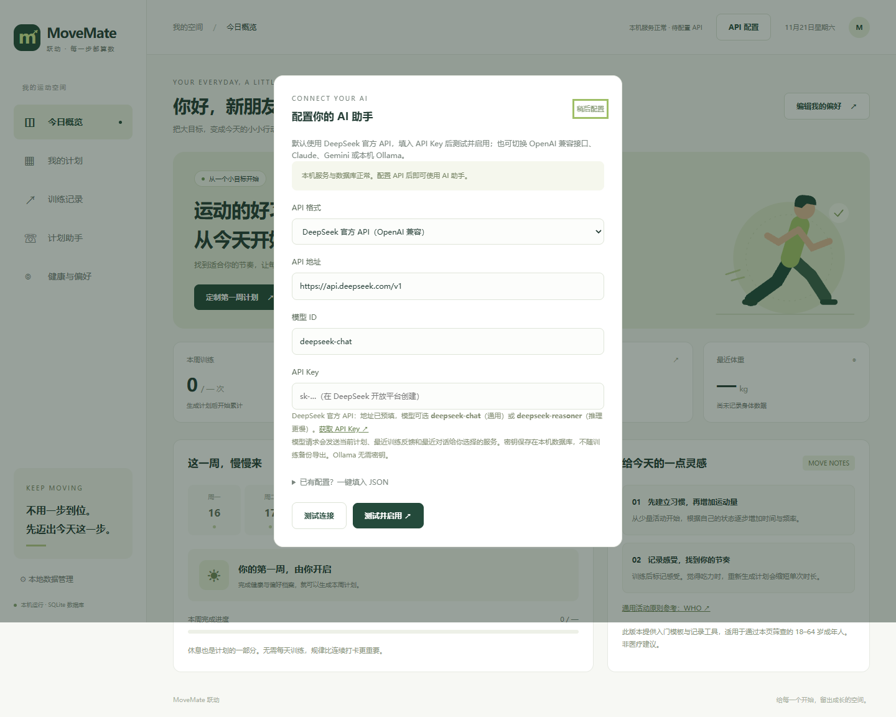

# MoveMate 3.2 · DeepSeek API 接入说明

本文说明如何把 MoveMate 的计划助手接到 DeepSeek 官方 API。配置只需一次，之后启动应用会自动做一次连通性检查。

## 1. 准备 API Key

1. 打开 <https://platform.deepseek.com/api_keys>。
2. 登录 DeepSeek 开放平台。
3. 创建一个 API Key，并复制完整的 `sk-...` 字符串。
4. 确认账户有可用余额。DeepSeek 按实际请求计费，连接测试也会产生一次很小的请求。

不要把 API Key 写进源码、博客、Git 提交或截图。MoveMate 只把它保存在本机数据库 `config` 记录中。

## 2. 在应用内配置

首次启动 MoveMate 会自动打开配置向导：



按以下顺序操作：

1. **API 格式**：保持 `DeepSeek 官方 API（OpenAI 兼容）`。
2. **API 地址**：已预填 `https://api.deepseek.com/v1`，通常不需要改。
3. **模型 ID**：`deepseek-chat` 适合日常问答；需要更多推理时改为 `deepseek-reasoner`。
4. **API Key**：粘贴上一步创建的 Key。
5. 点击 **测试连接**。看到“连接成功”后，再点击 **测试并启用**。

保存后，右上角状态会显示“本机服务正常 · deepseek-chat”（或你选择的模型）。进入“计划助手”即可提问。

如果之前已经保存过 Key，再次打开配置时 Key 输入框为空，这是有意的安全设计。格式和地址不变时留空即可继续使用旧 Key；修改格式或地址后需要重新填写。

## 3. JSON 快速配置

配置向导底部可以展开“已有配置？一键填入 JSON”：

```json
{
  "format": "deepseek",
  "base_url": "https://api.deepseek.com/v1",
  "model": "deepseek-chat",
  "api_key": "sk-你的密钥"
}
```

“填入配置”只把值填进表单，仍需点击“测试并启用”才会发出请求并保存。

## 4. 请求格式与边界

`deepseek` 预设使用 OpenAI Chat Completions 兼容协议，实际请求为：

```text
POST https://api.deepseek.com/v1/chat/completions
Authorization: Bearer sk-...
Content-Type: application/json
```

请求体包含：

- `model`：`deepseek-chat` 或 `deepseek-reasoner`
- `messages`：系统提示、当前计划、最近三条训练反馈、最近对话和本轮问题
- `stream: false`

应用只解析 `choices[0].message.content` 的文本，不执行模型返回的 HTML、代码或工具命令。姓名、年龄、体重、健康备注不会自动发送；如果你在聊天框主动输入，它们会作为对话内容发送给 DeepSeek。

`deepseek-reasoner` 的推理内容不会写入数据库，也不在页面展示；页面只显示最终回答。

## 5. 常见错误

| 现象 | 可能原因 | 处理 |
| --- | --- | --- |
| HTTP 401 | Key 错误、被删除或复制不完整 | 重新创建并粘贴完整 Key |
| HTTP 402 | 账户余额不足 | 在 DeepSeek 平台充值或换用其他 Key |
| HTTP 404 | 地址或模型 ID 不匹配 | 确认地址为 `https://api.deepseek.com/v1`，模型为 `deepseek-chat` |
| HTTP 429 | 请求限流 | 稍后重试，避免连续点击测试 |
| 连接失败 / 超时 | 网络、代理、证书或地区限制 | 检查网络和代理；确认可访问 DeepSeek API |
| “接口返回重定向” | 填了网页地址或会被重定向的地址 | 填 API 基础地址，不要填控制台网页地址 |

应用不会在错误提示中回显 API Key，也不会把上游错误响应体原样展示给页面。

## 6. 验证范围

仓库内自动测试使用本地模拟上游，遍历 `deepseek`、`openai`、`responses`、`anthropic`、`gemini`、`ollama` 六种格式，并验证 DeepSeek 预设、地址、模型、请求头、配置保存和聊天写库。

交付前已使用临时真实 Key 完成一次 `/api/config/test` 和一轮 `/api/chat`，默认模型 `deepseek-chat` 返回了真实中文回答。Windows 11 x64 原生窗口中也已实际完成 DeepSeek 配置，并在计划助手页面显示中文回复。测试密钥没有写入交付包、日志或文档。

其他人的账号权限、余额、地区可用性和模型名称仍需用自己的 Key 在应用内点击“测试连接”确认。助教或队友复现时也应使用自己的 Key，不要把个人 Key 打进压缩包。
