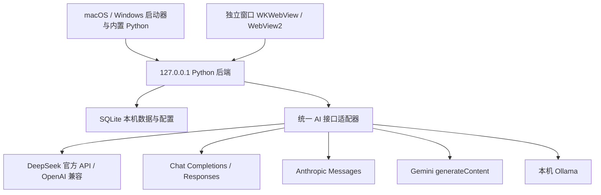

# MoveMate 3.2 系统设计

浏览器页面、本机后端和 SQLite 构成单用户本地应用。计划使用确定性规则，AI 对话使用所配置的真实模型。

## 启动

启动器检查运行环境并复用已有服务。后端初始化数据库并运行 quick_check；失败时终止并展示错误。页面启动时连接 bootstrap、health 和 state，缺少 API 时自动打开向导。已有配置时执行简短模型调用自检，连接失败仍可使用计划与记录。

## 接口

| 接口 | 行为 |
| --- | --- |
| GET /api/bootstrap | 为本机页面取得随机会话 token |
| GET /api/health | 数据库、版本与已配置模型状态，不返回密钥 |
| GET /api/state | 读取状态与修订号 |
| POST /api/state | 校验状态、检查修订号、原子写入；冲突返回 409 |
| GET /api/config | 格式、地址、模型及是否有密钥，不回传密钥 |
| POST /api/config/test | 实际调用所选接口，检查请求与返回格式 |
| POST /api/config/save | 校验并保存配置 |
| POST /api/chat | 用数据库中当前计划和最近反馈调用模型，成功后保存会话 |

所有业务接口要求本次服务生成的 token。服务校验 Host、Origin，限制请求大小并只监听回环地址。静态服务只开放页面和三份前端资源，数据库放在用户数据目录。上游 HTTP 重定向被拒绝，避免密钥被带到非预期地址；错误消息不回显上游响应体。

## 存储

SQLite 的 kv 表保存 state、revision 和 config。state 继续采用版本 2 的前端数据结构，应用版本为 3.2.0。训练资料与 API 配置分开，导出 state 不包含 API Key。SQLite 事务与修订号阻止旧页面覆盖新数据。用户数据保存在操作系统账户的数据目录，与安装包隔离。

这是本地单用户模型；没有公网账号系统、租户或管理员角色。数据库为本机文件，没有应用层加密。多页面同时编辑时，后提交的旧修订会被拒绝，刷新后再继续。

## AI

`backend/ai.py` 统一完成配置校验、请求转换、HTTP 调用、错误映射与响应解析。支持六种格式：`deepseek`、`openai`、`responses`、`anthropic`、`gemini`、`ollama`。其中 DeepSeek 官方 API 复用 OpenAI Chat Completions 兼容协议，预设地址 `https://api.deepseek.com/v1`，默认模型 `deepseek-chat`，并给出 `deepseek-reasoner` 选项。密钥只由后端放入对应认证头；Ollama 支持无密钥本机服务。模型 ID 可自定义，不依赖写死的模型目录。

对话使用最近十二条消息，当前计划的日程与解释，以及最近三条训练的日期、感受和分钟数。姓名、年龄、体重、健康备注不自动发送。接口测试只发送简短测试文本。输出作为文本渲染，不执行模型返回的 HTML、代码或工具命令。

训练计划仍由 `src/domain.js` 生成，风险筛查前置，AI 无权直接修改日程或数据库。这样既能进行真实模型对话，也能保持训练安排的可检查性。

## 运行环境与打包

macOS 包包含 Apple Silicon 和 Intel 的 python-build-standalone，启动脚本按架构选择。Windows 包包含 python.org x64 嵌入式 Python。Python 标准库提供 HTTP、SQLite、TLS、JSON，无需 pip 安装依赖。证书包随应用提供。源文件与运行环境的许可信息随包保留。

## 3.1 独立窗口更新

macOS 采用原生 Cocoa 窗口和 WKWebView，提供通用架构 MoveMate.app；Windows 采用 pywebview / WinForms / WebView2。窗口内承载相同前端，后端仍仅监听回环地址。macOS 关闭应用时结束自己的后端子进程；Windows 关闭窗口时关闭服务线程。macOS 禁止向应用包写入 Python 字节码缓存，运行数据始终放在用户目录。

Windows 包保留启动.bat，并提供无控制台的启动.vbs；依赖系统 WebView2 Runtime 和 .NET Framework 4.8，附微软官方 WebView2 安装器供缺少组件时手动运行。Windows 11 x64 已实测通过：原生窗口标题“MoveMate 跃动”、后端监听 `127.0.0.1:8765`、SQLite 正常、`app=movemate`、`version=3.2.0`，并已完成 DeepSeek 配置和聊天页面验证；其他 Windows 版本与 WebView2 Runtime 版本仍需复核。

## 3.2 DeepSeek 预设

配置向导默认选择 DeepSeek，自动填入官方地址和 `deepseek-chat`。用户只需要粘贴 API Key，点“测试连接”后保存。`deepseek-reasoner` 作为第二模型选项；应用只解析最终回答，不保存或展示推理内容。

配置前发起的聊天问题会暂存在前端，保存成功后自动继续发送；用户关闭配置向导则丢弃暂存问题。健康接口新增 `app` 标识，启动器用应用标识而不是固定版本号判断是否可以复用已有服务。后端协议测试覆盖六种格式，浏览器验收覆盖 DeepSeek 配置、计划、打卡、对话和移动端布局。
